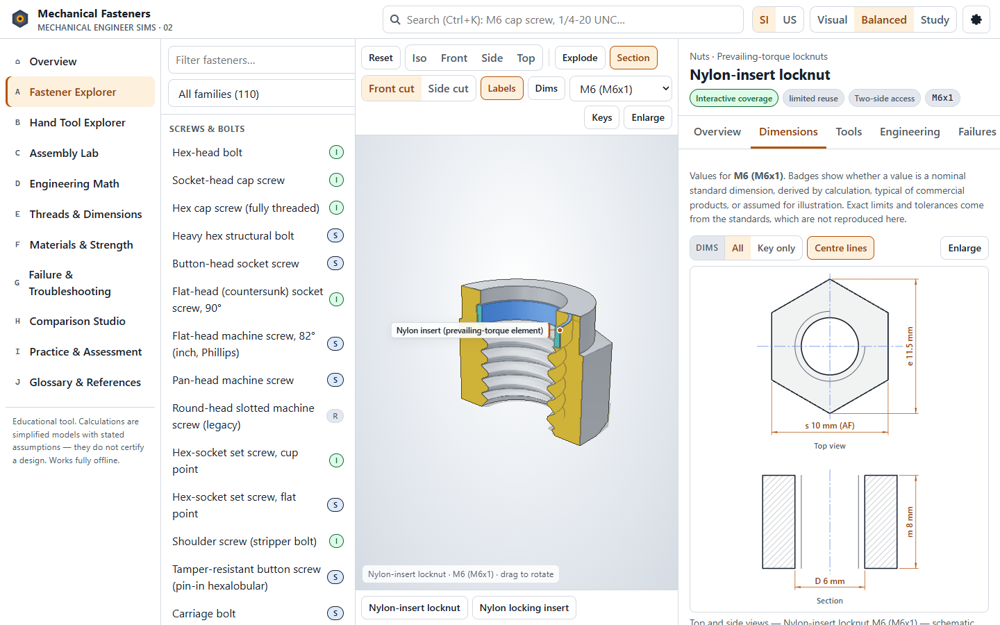
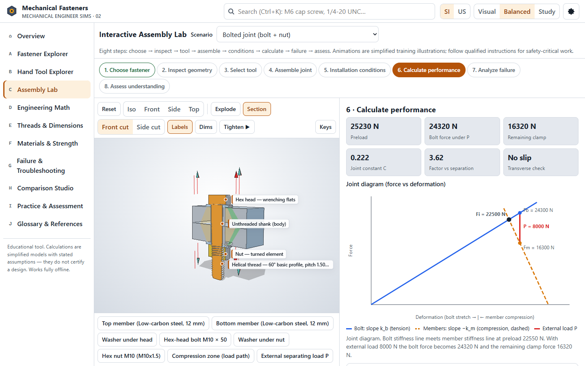
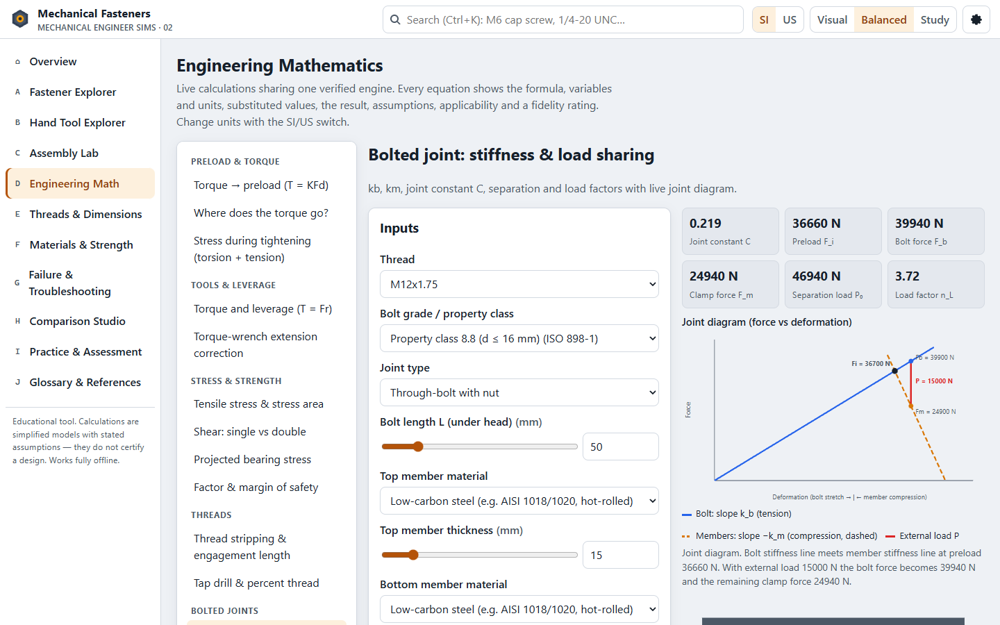

# Mechanical Fasteners

**An interactive mechanical engineering learning environment for fasteners, hand tools, assembly techniques and joint mechanics.**

Mechanical Fasteners lets you study physical hardware the way an engineer works with it. You can rotate a 3D model, cut it open, read its dimensions, pick the tool that fits it, assemble it into a joint, and calculate what happens when the joint is loaded. Each part of the application is tied to the others:

- the geometry of a fastener determines which tools engage it;
- the tool and installation method determine the preload;
- the preload and the joint's stiffness determine how the joint carries load and how it fails.

It is built for engineering education and technical training.

### **[Launch Mechanical Fasteners](https://samfclement.github.io/Mechanical-Fasteners/)**

Free, runs in the browser, fully interactive, and needs no account. Everything is bundled with the page, so it makes no requests to third-party services.

*Fastener Explorer: a nylon-insert locknut in section view, with its dimensioned drawing.*

---

## Key features

### Fastener Explorer
110 fastener types in nine families, with 236 size variants:
- screws and bolts;
- nuts;
- washers;
- pins and locating fasteners;
- retaining rings and clips;
- rivets;
- threaded inserts;
- anchors;
- latches and specialty hardware.

Each type has an interactive 3D model, a description of how it works, typical applications, cautions, materials and grades. A dimension table labels every value as a nominal standard dimension, a derived value, a typical commercial value or an illustrative assumption.

### Hand Tool Explorer
82 hand tools and instruments in nine families:
- screwdrivers and bits;
- wrenches;
- sockets and ratchets;
- torque tools;
- pliers, including retaining-ring pliers;
- riveting and insert-installation tools;
- thread preparation and repair;
- measuring and inspection, such as calipers, micrometers and thread gauges;
- punches and extractors.

Tool-to-fastener compatibility comes from structured drive, size and thread data, not name matching. Each tool–fastener pairing is rated exact, limited, incompatible or "insufficient information". Look-alike mistakes are called out, such as an inch hex key in a metric socket or a Phillips driver in a Pozidriv recess.

### Assembly Lab
16 assembly scenarios, each following the same eight steps: choose, inspect, select tool, assemble, set installation conditions, calculate, analyse failure, assess. The scenarios cover:

- bolted and tapped joints;
- dowel, clevis/cotter, spring-pin and two-pin location;
- external and internal retaining rings;
- blind, solid and rivet-nut joints;
- threaded inserts in different parent materials;
- a wedge anchor, as a concept only;
- washer and locknut stack mistakes;
- a worm-drive hose clamp.

About 79 injectable faults show their mechanical consequence, inspection clues and corrective action.

### Engineering Mathematics
25 calculators. Each one shows the formula, variables and units, the substituted values, the result, its assumptions and applicability, and a fidelity label. Topics include:

- thread geometry and stress areas;
- torque–preload relations and tightening scatter;
- tensile, shear and bearing stress;
- thread stripping;
- joint stiffness and load sharing, with a joint diagram;
- fatigue (Goodman);
- ISO 286 fits and tolerance stack-ups;
- thermal preload change and embedment;
- slip resistance;
- pins, rivets and press fits.

Calculators work in SI and US customary units.

### Engineering drawings, threads and fits
- **Dimensioned drawings** generated from the same size data as the 3D models, with centre lines, hidden lines, section hatching and thread conventions.
- **A thread designation parser** for metric and unified threads.
- **An ISO 286 hole/shaft fit calculator.**
- **Teaching material on GD&T and inspection.**

### Failure analysis
23 failure scenarios cover:
- self-loosening;
- overtightening and yield;
- thread stripping;
- fatigue;
- joint separation;
- galling;
- hydrogen embrittlement;
- corrosion;
- wrong or worn tools;
- misassembly.

Most scenarios can be recreated interactively, and each pairs its mechanism with inspection clues and corrective action.

### Assessments and reference tools
- **Practice:** parametric and curated questions, with local progress tracking that you can export and import.
- **Comparison studio.**
- **Offline search:** faceted search across fasteners, tools, threads and terms.
- **Glossary:** 144 terms.
- **Source list:** the references behind the engineering content.

---

## Engineering visualization

The 3D views are built to explain hardware, not to decorate it.

| Capability | What it shows |
|---|---|
| Procedural 3D models | Geometry generated from size data. Threads are true helices on the ISO basic profile, and nuts are threaded in phase with their bolts. |
| Section and exploded views | Cut-away views with colour-coded cut faces, plus exploded assemblies. Hidden features become visible: thread engagement, locking elements, rivet mandrels, insert coils and anchor expansion clips. |
| Feature labels and selection | Callouts anchored to features, and a part list for selecting and highlighting individual components. |
| Dimension annotations | 3D dimension lines on the model, plus dimensioned 2D drawings with a key-dimension mode and layer toggles. |
| Rendering | Matte, physically based finishes (zinc, black oxide, stainless, brass and others) with thin edge lines for silhouettes, part boundaries and creases. |
| Camera control | Orbit, pan and zoom by mouse, touch or keyboard, with standard views (iso, front, side, top). |
| Tools in action | Plier squeeze kinematics, a ratchet mechanism cutaway, tool tip close-ups, and nut tightening along the real thread helix in the Assembly Lab. |

---

## Who it is for

- Mechanical engineering students
- Mechanical design engineers
- Manufacturing engineers
- Maintenance technicians
- Assembly technicians
- Anyone learning how mechanical joints are specified, assembled and inspected

---

## Accessibility and usability

- **Keyboard:** full keyboard operation, including a skip link and keyboard control of the 3D camera, section, explode and labels.
- **Responsive layouts** for desktop, laptop, tablet and phone, with three layout presets (Visual, Balanced, Study).
- **High-contrast mode, text scaling up to 200 % and reduced-motion support.**
- **Text alternatives:**
  - equations include MathML;
  - every plot has a data-table alternative;
  - the 3D view has a text description;
  - all essential information is also given as text, tables and drawings.
- **Testing:** automated accessibility checks (axe-core) report no serious or critical issues on the main pages. Manual screen-reader testing has not yet been done, so full WCAG conformance is not claimed.
- **Offline:** the application makes no network requests beyond its own files. A self-contained single-file offline build is produced from the source project for classroom use; it is not distributed from this repository.

---

## Engineering accuracy and limitations

This is an educational simulation, not certified design-analysis software.

- **Calculations** use textbook engineering models with stated assumptions. Some mechanisms and strength checks use documented approximations, and each is labelled with its fidelity.
- **Standards** are cited by name; their tables are not reproduced.
- **Manufacturer-rated values** are deliberately not given, because they are product-specific. This covers anchor capacities, insert and retaining-ring ratings, and installation torques.

For real hardware selection and any safety-critical application, consult the manufacturer's specifications and the applicable engineering standards.

---

## Related engineering simulations

**[Kinetic Transfer Mechanisms](https://samfclement.github.io/Kinetic-Transfer-Mechanisms/)** is an interactive engineering learning program covering gears, belts, cams, shafts and linkages.

---

## Project status

Mechanical Fasteners is publicly available and maintained. This repository contains the compiled website served by GitHub Pages. It is updated automatically from a separately maintained source repository after each change passes the automated test suite.

Third-party libraries (React, three.js, three-mesh-bvh, three-bvh-csg and KaTeX) are used under their MIT licences; see [THIRD_PARTY_NOTICES.txt](THIRD_PARTY_NOTICES.txt).
